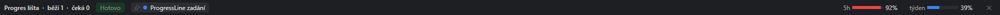

# Progres lišta

Tenká lišta na horním okraji obrazovky Windows, která ukazuje stav všech běžících sessions Claude Code a vyčerpání 5h a týdenního limitu. Stačí mrknout nahoru a vím, jestli po mně některý agent něco chce.



## Proč

Několik orchestračních agentů Claude zpracovává tickety z GitHubu. Většinu času jen čekám, až doběhnou, nebo až budou něco chtít. Bez lišty musím pořád přepínat okna a kontrolovat jednotlivé sessions.

## Co umí

- **Chová se jako hlavní panel Windows.** Lišta se registruje jako AppBar (`SHAppBarMessage`) a rezervuje si horních 30 px. Maximalizovaná okna končí pod ní a nic ji nepřekryje.
- **Stav každé session:** 🔵 běží, 🟠 potřebuje pozornost (čeká na povolení nebo vstup, se zvukem), 🟢 hotovo. U každé je, jak dlouho v tom stavu je.
- **Názvy z levého panelu** desktop aplikace Claude. Sessions z CLI mají název složky.
- **Špendlík:** připnuté sessions jsou vždy vlevo a nikdy se neschovají.
- **Záložka Hotovo:** sem spadnou nepřipnuté sessions hotové déle než 10 minut. Klik ukáže seznam, pravý klik vynuluje počítadlo.
- **Limity:** ukazatele 5h a týdenního okna, modré / od 70 % oranžové / od 90 % červené.
- Pravý klik na session ji odebere z lišty (např. když skončila bez `SessionEnd`).

## Instalace

Potřebuješ Windows 10/11, [.NET 9 Desktop Runtime](https://dotnet.microsoft.com/download/dotnet/9.0) a Node.js.

1. Stáhni zip z [Releases](../../releases) a rozbal ho.
2. Nainstaluj hooky Claude Code (přidají se do `~/.claude/settings.json`, záloha vedle):
   ```
   node hooks/install.js
   ```
3. Spusť `ProgresLista.exe`.
4. Pro ukazatele limitů se jednou přihlas v CLI: `claude` → `/login`.

Odinstalace hooků: `node hooks/install.js --remove`.

## Jak to funguje

- Hooky Claude Code (`hooks/progres-hook.js`) zapisují stav každé session do `~/.claude/progres-lista/<session_id>.json`. Lišta složku sleduje.
- Názvy čte z metadat desktop aplikace v `%LOCALAPPDATA%\Claude-Data`. Není to veřejné rozhraní, po aktualizaci aplikace se může změnit; lišta pak ukáže název složky.
- Limity čte z `api.anthropic.com/api/oauth/usage` tokenem z `~/.claude/.credentials.json`. Prošlý token obnoví a uloží zpět. Token jde jen na Anthropic.
- Připnutí a počítadlo jsou v `~/.claude/progres-lista-state.json`.

## Vývoj

```
dotnet build src/ProgresLista -c Release
```

Příspěvky zvenku nepřijímám, viz [CONTRIBUTING.md](CONTRIBUTING.md).

## Licence

[CC BY-NC-SA 4.0](LICENSE)
